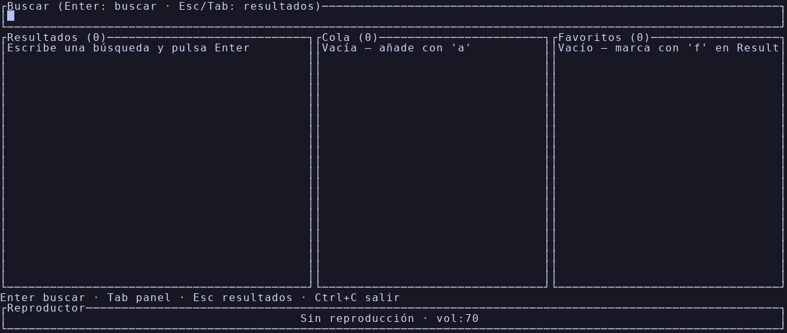

<p align="center">
  
</p>

**Toda tu música, sin salir de la terminal.**

[](https://github.com/devFuentesQuijon/ShellMusic/actions/workflows/ci.yml)
[](LICENSE)

TUI ultraliviana para buscar y reproducir música de YouTube Music y SoundCloud. Escrita en Rust con ratatui; la reproducción corre a cargo de **mpv** (controlado por JSON IPC) y la búsqueda/resolución de **yt-dlp**. Binario único para Linux, macOS y Windows.



## Características

- **Busca y reproduce** YouTube Music y SoundCloud sin abrir el navegador (`m` cambia de proveedor en caliente); también acepta URLs pegadas de vídeo, playlist o Bandcamp.
- **Cola gestionable y persistente**: añade, quita, reordena, baraja; al cerrar y reabrir, la cola, la pista y la posición se reanudan donde lo dejaste (a prueba de `kill -9`).
- **Modo radio** con cinco sub-modos (artista, similares, random, random género, rarezas) y prefetch sin pausa.
- **Favoritos y playlists locales** con escritura atómica y recuperación ante archivos corruptos: cero cuentas, cero nube.
- **Estadísticas de escucha** (`t`), **letras** (`L`, vía lrclib.net), panel **«sonando ahora»** con carátula (`i`) y autocompletado de búsqueda desde tu historial.
- **Portabilidad** (`X`/`I`): exporta e importa playlists y favoritos (JSON/M3U).
- **Integración con el sistema**: notificaciones de escritorio y, en Linux, MPRIS (teclas multimedia, widgets, KDE Connect).
- **Temas de color** configurables y **título de pestaña** con la pista en reproducción.
- **Robusta**: defensas anti-bot de YouTube en cadena (rotación de clientes, cookies, PO Token), auto-respawn de mpv y reintentos ante fallos transitorios.


## Instalación

### Opción 1: binario precompilado

Descarga el binario para tu SO desde [GitHub Releases](https://github.com/devFuentesQuijon/ShellMusic/releases) (`smusic-linux-x86_64`, `smusic-macos-aarch64`, `smusic-windows-x86_64.exe`), dale permiso de ejecución (`chmod +x`) y ponlo en tu `PATH`.

### Opción 2: compilar

```sh
# instalación como comando del sistema (~/.cargo/bin debe estar en el PATH)
cargo install --path .
smusic

# o durante desarrollo, sin instalar
cargo run --release
```

### Arranque con tema y reproducción directa

```sh
smusic --theme dracula          # tema empaquetado sin tocar config.toml
smusic --play "daft punk"       # busca y suena la primera coincidencia
smusic --theme thriller --play "thriller"   # ambas a la vez
```

Los temas disponibles (`--help` los lista): dracula, frankenstein, bride, wolfman, mummy, invisible, lagoon, thriller — la [colección completa con muestras](docs/temas.md).

## Dependencias

ShellMusic necesita `mpv` y `yt-dlp` en el `PATH`. Si falta alguno, muestra las instrucciones y sale sin panic.

| SO | Instalación |
|---|---|
| Linux | `sudo apt install mpv` (o tu gestor de paquetes) + `pip install yt-dlp` |
| macOS | `brew install mpv yt-dlp` |
| Windows | `winget install mpv yt-dlp` |

## Documentación

La guía completa vive en [`docs/`](docs/README.md):

- **Manual**: `man smusic` — página de manual en `docs/smusic.1` (instalación: `sudo cp docs/smusic.1 /usr/local/share/man/man1/`)
- [Atajos de teclado](docs/atajos.md) · [Cola, repetición y radio](docs/cola-y-radio.md) · [Playlists y favoritos](docs/playlists.md)
- [Configuración y temas](docs/configuracion.md) · [Integración con el sistema](docs/integracion-sistema.md)
- [Portabilidad y estadísticas](docs/portabilidad.md) · [Descubrimiento](docs/descubrimiento.md)
- [Bloqueo anti-bot de YouTube](docs/anti-bot.md) · [Aviso legal](docs/legal.md) · [Desarrollo](docs/desarrollo.md)

## Licencia

[MIT](LICENSE). Uso personal; consulta el [aviso legal](docs/legal.md).
