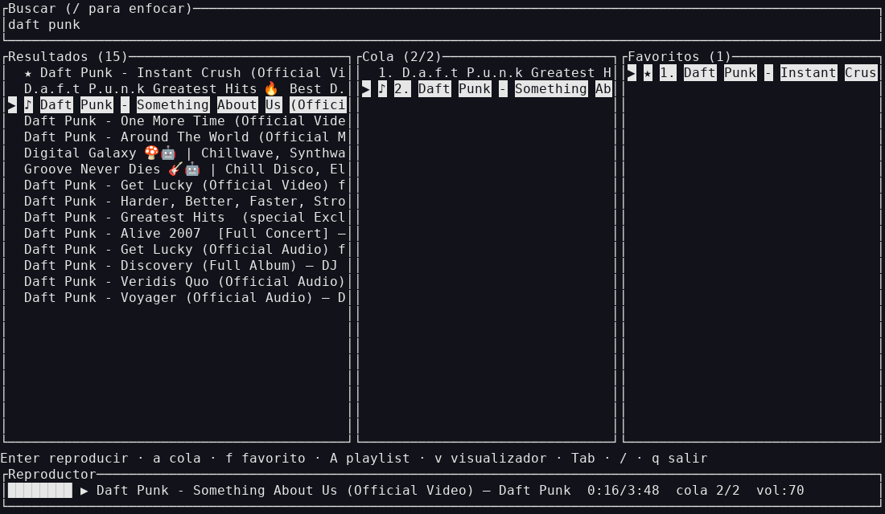

# ShellMusic

[](https://github.com/devFuentesQuijon/ShellMusic/actions/workflows/ci.yml)

TUI ultraliviana para buscar y reproducir música de YouTube Music desde la terminal. Escrita en Rust con ratatui; la reproducción corre a cargo de **mpv** (controlado por JSON IPC) y la búsqueda/resolución de **yt-dlp**.



## Instalación

### Opción 1: binario precompilado

Descarga el binario para tu SO desde [GitHub Releases](https://github.com/devFuentesQuijon/ShellMusic/releases) (`smusic-linux-x86_64`, `smusic-macos-aarch64`, `smusic-windows-x86_64.exe`), dale permiso de ejecución (`chmod +x`) y ponlo en tu `PATH`.

### Opción 2: compilar

```sh
# instalación como comando del sistema (~/.cargo/bin debe estar en el PATH)
cargo install --path .
smusic

# o durante desarrollo, sin instalar
cargo run --release
```

## Dependencias

ShellMusic necesita `mpv` y `yt-dlp` en el `PATH`. Si falta alguno, muestra las instrucciones y sale sin panic.

| SO | Instalación |
|---|---|
| Linux | `sudo apt install mpv` (o tu gestor de paquetes) + `pip install yt-dlp` |
| macOS | `brew install mpv yt-dlp` |
| Windows | `winget install mpv yt-dlp` |

## Atajos de teclado

| Tecla | Contexto | Acción |
|---|---|---|
| Texto + Enter | Búsqueda | Ejecutar búsqueda |
| Esc / Tab | Búsqueda | Pasar a resultados |
| Tab / Shift+Tab | Resultados / Cola / Favoritos | Ciclar foco: Búsqueda → Resultados → Cola → Favoritos |
| ↑ / ↓ (o k / j) | Resultados / Cola / Favoritos | Mover selección |
| Enter | Resultados | Reproducir selección (la añade a la cola si no está) |
| a | Resultados | Añadir a la cola sin interrumpir la reproducción |
| f | Resultados / Cola | Marcar / quitar favorito (o de la pista que suena si no hay selección) |
| Enter | Cola | Reproducir la pista seleccionada |
| d | Cola | Eliminar de la cola |
| J / K | Cola | Mover la pista abajo / arriba |
| Enter | Favoritos | Reproducir (y añadir a la cola) |
| a | Favoritos | Añadir a la cola sin interrumpir |
| d / f | Favoritos | Quitar de favoritos |
| Espacio | Resultados / Cola / Favoritos | Play / pausa |
| s | Resultados / Cola / Favoritos | Stop |
| + / - | Resultados / Cola / Favoritos | Volumen arriba / abajo |
| n / p | Resultados / Cola / Favoritos | Siguiente / anterior pista de la cola (sin bucle) |
| / | Resultados / Cola / Favoritos | Foco a búsqueda |
| q | Resultados / Cola / Favoritos | Salir |
| P | Resultados / Cola / Favoritos | Abrir gestor de playlists (overlay) |
| A | Resultados / Cola / Favoritos | Añadir la pista seleccionada (o la que suena) a una playlist |
| v | Resultados / Cola / Favoritos | Activar / desactivar el visualizador de espectro |
| Ctrl+C | Global | Salir |

Con el overlay de playlists abierto (modal; captura todas las teclas salvo Ctrl+C):

| Tecla | Vista | Acción |
|---|---|---|
| ↑ / ↓ (o k / j) | Todas | Mover selección |
| n | Lista | Nueva playlist (pide nombre) |
| d | Lista | Eliminar playlist (pulsa `d` dos veces para confirmar) |
| Enter | Lista | Abrir contenido |
| Enter | Contenido | Reproducir la pista (la añade a la cola) |
| a | Contenido | Añadir la pista a la cola sin interrumpir |
| A | Contenido | Reproducir la playlist entera (encola todo y suena la primera) |
| d | Contenido | Quitar la pista de la playlist |
| J / K | Contenido | Reordenar la pista |
| Esc | Lista / Contenido / Selector | Cerrar / volver / cancelar |

## Playlists

Playlists locales gestionadas desde el overlay modal (`P`): crear (`n`), eliminar (`d` dos veces), abrir (`Enter`) y, dentro, reordenar (`J`/`K`), quitar pistas (`d`) o reproducir todo (`A`). Con `A` sobre cualquier pista la añades a una playlist existente o a una nueva (sin duplicados por pista). Los nombres de playlist son únicos.

Se guardan en `playlists.json` junto a `favorites.json` (`~/.local/share/shellmusic/playlists.json` en Linux, `~/Library/Application Support/shellmusic/playlists.json` en macOS, `%APPDATA%\shellmusic\playlists.json` en Windows), con escritura atómica y recuperación ante archivo corrupto (`.bak`).

Mientras se edita la búsqueda, las teclas se capturan como texto; los controles de reproducción aplican con el foco en Resultados, Cola o Favoritos.

## Favoritos

`f` marca o desmarca la pista seleccionada (o la que suena) como favorita; las favoritas llevan marcador `★` en todos los paneles. El panel Favoritos (cuarta vista del ciclo `Tab`) permite reproducirlas (`Enter`), encolarlas (`a`) o quitarlas (`d`).

Se guardan en `favorites.json` en el directorio de datos nativo (`~/.local/share/shellmusic/favorites.json` en Linux, `~/Library/Application Support/shellmusic/favorites.json` en macOS, `%APPDATA%\shellmusic\favorites.json` en Windows), con escritura atómica. Si el archivo está corrupto se aparta a `favorites.json.bak` y se empieza con lista vacía, sin cerrar la app. Todo es local: no hay cuentas ni sincronización.

## Cola de reproducción

El panel derecho muestra la cola: posición, título, artista y duración, con `♪` en la pista que suena y `▶` en la seleccionada. La barra del reproductor muestra la posición en la cola (`cola 3/12`).

- Al terminar una pista de forma natural, avanza automáticamente a la siguiente de la cola (autoplay). `s` (stop) no dispara autoplay.
- Si eliminas con `d` la pista que está sonando, se reproduce la que ocupa su lugar; si era la última, se detiene.

## Configuración

En el primer arranque se crea `config.toml` en la ruta nativa de configuración (`~/.config/shellmusic/config.toml` en Linux, `~/Library/Application Support/shellmusic/config.toml` en macOS, `%APPDATA%\shellmusic\config.toml` en Windows):

```toml
[general]
results_per_search = 15   # 1-50

[audio]
initial_volume = 70       # 0-100

[youtube]
cookies_from_browser = "auto"   # "auto" | "firefox"/"chrome"/... | "" (nunca usar cookies)
player_client = "android"          # cliente de YouTube que emula yt-dlp
remote_components = "ejs:github"   # solucionador de retos JS de yt-dlp ("" = desactivado)
```

## Bloqueo anti-bot de YouTube

YouTube bloquea la resolución de streams desde muchas IPs (HTTP 429 "Sign in to confirm you're not a bot" o HTTP 403 al abrir el stream). La búsqueda suele funcionar, pero la reproducción falla. La sección `[youtube]` lo mitiga:

- `cookies_from_browser`:
  - `"auto"` (por defecto): reproduce primero **sin cookies**; solo si YouTube bloquea el stream, reintenta con las cookies de cada navegador instalado detectado (firefox, chrome, chromium, brave, edge, opera, vivaldi — firefox primero). El navegador que funciona se recuerda durante la sesión, así que las siguientes pistas no repiten el ciclo. Si todo falla, la UI te pide iniciar sesión en YouTube desde algún navegador instalado (basta una sesión de visitante, no hace falta cuenta).
  - `"firefox"`, `"chrome"`, ...: usa solo ese navegador, sin auto-detección. Requiere haber iniciado sesión de YouTube en él.
  - `""`: nunca usa cookies.
- `player_client`: el cliente `android` evita la exigencia de GVS PO Token que produce el 403 en los clientes web por defecto.
- `remote_components`: permite a yt-dlp descargar el solucionador de retos JS de firma desde GitHub; necesita un runtime JS instalado (`bun`, `deno` o `node`).

**Privacidad**: en modo `auto` la app solo lee las cookies del navegador cuando el intento sin cookies falla. Las cookies nunca salen de tu equipo: se pasan únicamente al proceso local de yt-dlp/mpv para autenticar la petición a YouTube.

Si la reproducción falla, el mensaje de error en la barra de estado incluye el motivo real reportado por mpv/yt-dlp.

## Tests de integración

Requieren `mpv`, `yt-dlp` y acceso a red:

```sh
cargo test -- --ignored
```

## Visualizador de espectro (opcional, solo Linux)

`v` activa una franja de barras animadas sobre la barra del reproductor. Desactivado por defecto para ahorrar recursos; también configurable:

```toml
[visualizer]
enabled = false   # arrancar con el visualizador activo
bands = 24        # 8-64
fps = 20          # 5-60
```

Requiere `parec` (PipeWire/PulseAudio; con fallback a `pw-cat`). **Limitaciones conocidas**: solo funciona en Linux (en otros SO `v` muestra un aviso) y captura el monitor del sink por defecto, es decir, **todo el audio del sistema**, no solo el de ShellMusic. Con el visualizador apagado no hay subproceso de captura ni coste de redibujado extra (el render vuelve a 500 ms por tick).
